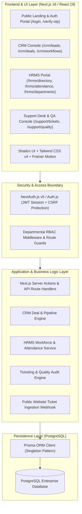
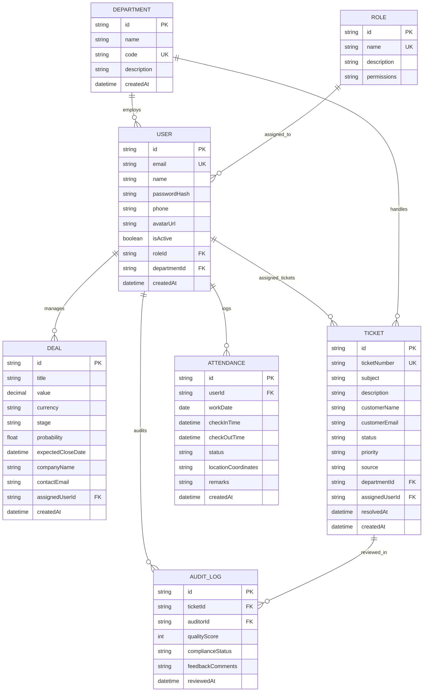

# BE SAAS — Enterprise Platform Requirements Specification
**Client / Brand:** BharatEdge Services  
**Platform Name:** BE SAAS (BharatEdge Enterprise Operating System)  
**Version:** 1.0.0-PROD-SPEC  
**Architecture Classification:** Modular Enterprise Monolith (Next.js App Router + PostgreSQL + Prisma ORM)

---

## 1. Executive Summary & Core Objectives

BE SAAS is a custom, multi-departmental enterprise SaaS operating system engineered exclusively for BharatEdge Services. The platform consolidates three mission-critical operational pillars into a unified, ultra-responsive web environment:
1. **Customer Relationship Management (CRM):** Inbound lead capture, stage-based deal pipelines, customizable sales workflows, and revenue analytics.
2. **Human Resource Management System (HRMS):** Multi-tiered department hierarchy, employee directory registry, biometric & geofenced attendance logs, shift tracking, and self-service portals.
3. **Customer Support Desk with Quality Oversight:** Omnichannel ticketing integrated with the BharatEdge public web presence, monitored, sampled, and audited by the Quality Department with SLA enforcement.

---

## 2. High-Level System Architecture

---

## 3. Technology Stack & Enterprise Standards

| Component / Concern | Specification | Purpose / Usage |
| :--- | :--- | :--- |
| **Framework** | Next.js 16.4+ (App Router) | Server Components, Streaming SSR, Turbopack, Nested Layouts |
| **Language** | TypeScript 5.0+ | Strict type safety, explicit interfaces, no implicit `any` |
| **Styling & Design System** | Tailwind CSS v4 + Shadcn UI | Semantic design tokens, accessible Radix-based primitives |
| **Iconography** | Lucide React | High-contrast, scalable micro-icons |
| **Micro-Animations** | Framer Motion (14+) | Smooth department transitions, hover states, telemetry cards |
| **Database** | PostgreSQL 16+ | ACID-compliant relational storage, indexed foreign keys |
| **ORM** | Prisma ORM (v6 LTS) | Type-safe queries, migration lifecycle, schema consistency |
| **Authentication & RBAC** | NextAuth.js v5 (Auth.js) | Session tokens, multi-factor OTP, departmental route guards |
| **Form Management** | React Hook Form + Zod | Schema-driven client/server validation |

---

## 4. Database Schema Entities & Relationships

### Entity Specifications:
1. **User:** Core corporate identity with foreign keys to `Department` and `Role`. Supports password hashing (bcrypt), two-factor OTP tokens, and active session status.
2. **Department:** Corporate division identifier (e.g., `EXECUTIVE`, `SALES_CRM`, `HR`, `QUALITY`, `SUPPORT`, `OPERATIONS`).
3. **Role & Permission:** Granular privileges enforcing multi-tiered access control (`SUPER_ADMIN`, `ADMIN`, `MANAGER`, `EMPLOYEE`, `SALES_REP`, `SUPPORT_AGENT`, `QUALITY_AUDITOR`).
4. **Deal:** Sales CRM entity tracking pipeline status (`LEAD`, `QUALIFIED`, `PROPOSAL`, `NEGOTIATION`, `CLOSED_WON`, `CLOSED_LOST`), deal value, expected close date, and account manager assignment.
5. **Ticket:** Support ticket lifecycle entity handling customer requests from both the internal desk and public website webhooks. Categorized by severity, department assignment, and SLA timers.
6. **Attendance:** Daily biometric/clock-in log records with timestamps, shift calculation, and geofence tracking.
7. **AuditLog:** Quality Department entity for compliance checks, scoring (1-5), and quality feedback on resolved support tickets.

---

## 5. Security & Role-Based Access Control (RBAC) Matrix

| Role | CRM Access | HRMS Access | Support Desk | Quality Audit Desk | System Admin |
| :--- | :--- | :--- | :--- | :--- | :--- |
| **SUPER_ADMIN** | Full Access | Full Access | Full Access | Full Access | Full Access |
| **ADMIN** | Full Access | Full Access | Full Access | Full Access | Restricted Config |
| **MANAGER** | Dept Scoped | Team Approvals | Team Scoped | View Only | None |
| **SALES_REP** | Own Deals/Leads | Self Profile | None | None | None |
| **EMPLOYEE** | None | Self Attendance | None | None | None |
| **SUPPORT_AGENT** | View Accounts | Self Profile | Manage Tickets | None | None |
| **QUALITY_AUDITOR**| None | Self Profile | Read All Tickets | Full Audit Rights| None |

---

## 6. UI/UX Design System & Aesthetic Guidelines

### Brand Identity & Palette:
- **Primary Brand Color:** Indigo 600 (`#4F46E5`), Indigo 500 (`#6366F1`)
- **Accent Tints:** Violet 600 (`#7C3AED`), Emerald 500 (`#10B981` - System Health & Active Status), Amber 500 (`#F59E0B` - Pending Approvals), Rose 600 (`#E11D48` - Critical Alerts & Escalations)
- **Backgrounds:** Light theme `slate-50` / `white`, Dark theme `slate-950` / `slate-900`
- **Borders & Dividers:** High-precision subtle borders (`slate-200` light / `slate-800` dark)
- **Typography:** Inter / System UI sans-serif font, tabular figures for currency and metrics (`font-mono`)

### Animation Standards:
- **Page Transitions:** Staggered upward fade (`opacity: 0 -> 1`, `y: 12 -> 0`, duration: 350ms, ease: `easeOut`).
- **Interactive Cards:** Subtle hover lift (`y: -3px`, `scale: 1.01`, duration: 200ms) with gentle border glow.
- **Micro-Interactions:** Active tap feedback (`scale: 0.99`), pulsating indicators for real-time ticket ingestion and system health.
- **Accessibility:** Reduced motion query detection (`@media (prefers-reduced-motion: reduce)`) gracefully bypassing translation animations.

---

## 7. Functional Module Requirements

### Module 1: Customer Relationship Management (CRM)
- **Lead Intake Engine:** Structured lead capture with source tags, qualification rating (Cold, Warm, Hot), and automated lead-to-deal conversion.
- **Deal Pipeline Kanban:** Drag-and-drop visual columns categorized by deal stage with live aggregated monetary totals.
- **Account Activities:** Contact history, client communication logs, and scheduled next actions.

### Module 2: Human Resource Management System (HRMS)
- **Workforce Directory:** Filterable grid with employee search, role badges, department tags, and status switches.
- **Attendance & Time Tracking:** Daily punch in/out timestamps, calculation of shift hours, leaves balance, and CSV reporting export.
- **Department Hierarchy:** Visual department structure with managerial chains and role permission boundaries.

### Module 3: Customer Support Desk & Quality Assurance
- **Public Ingestion API:** Secure webhook receiving contact form inquiries from `bharatedge.com`, auto-creating tickets with deduplication.
- **Ticketing Console:** Filter by status (`OPEN`, `PENDING_CUSTOMER`, `ESCALATED`, `RESOLVED`), priority tag, and assignment.
- **Quality Department Audit Console:** Dedicated interface for Quality Auditors to sample closed tickets, score agent responses against QA rubrics, and trigger corrective action flags.

